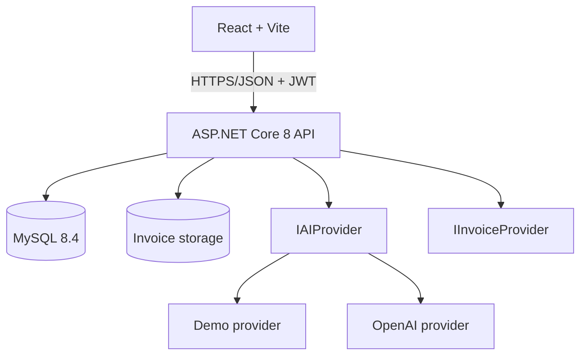
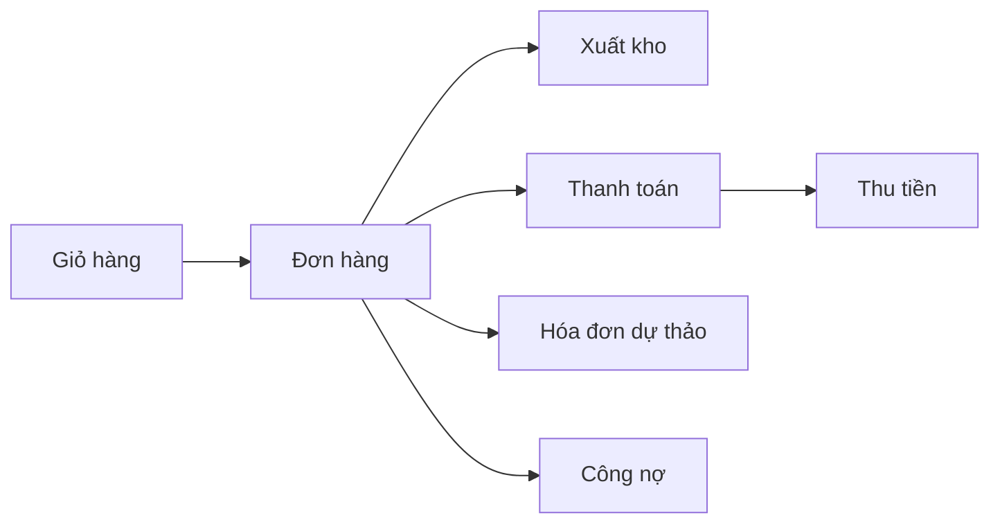

# TaxFlow AI Architecture

## Quy tắc kiến trúc

- Tất cả dữ liệu nghiệp vụ gắn với `CompanyId`; người dùng chỉ truy cập doanh
  nghiệp được phân quyền qua `CompanyUsers`.
- JWT chứa mã người dùng và vai trò. Backend luôn là nơi tính tiền, VAT và tồn kho.
- OCR không ghi thẳng vào sổ: `AI -> Validation -> User Review -> Confirm -> Database`.
- `DemoInvoiceProvider` không thể phát hành hóa đơn hợp pháp; trạng thái chỉ dừng
  ở `Pending` cho đến khi có nhà cung cấp hóa đơn điện tử thật.
- Dashboard AI và chatbot chỉ tổng hợp dữ liệu đã có trong MySQL.

## Luồng POS

## Apple Silicon

Các image chính thức `node:22-alpine`, `nginx:alpine`,
`mcr.microsoft.com/dotnet/*:8.0` và `mysql:8.4` đều được dùng theo manifest
multi-architecture; Compose không đặt `platform: linux/amd64`.
